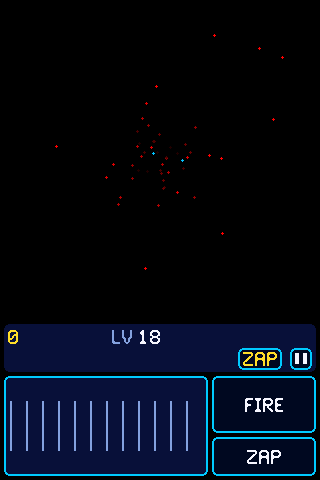
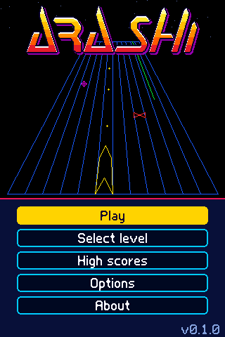
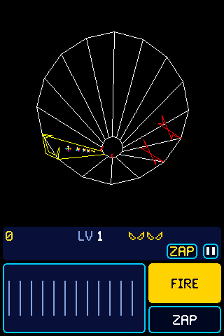
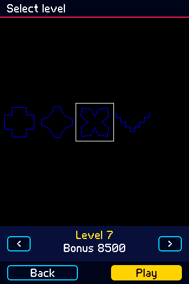
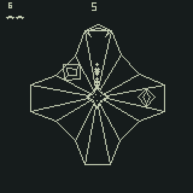
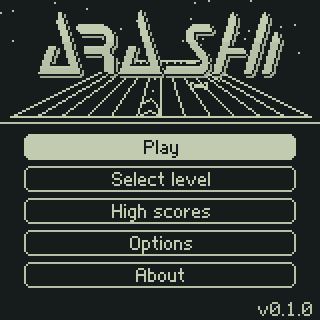
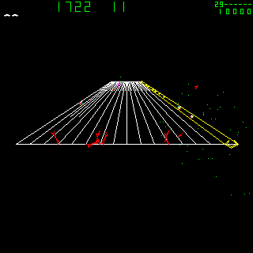
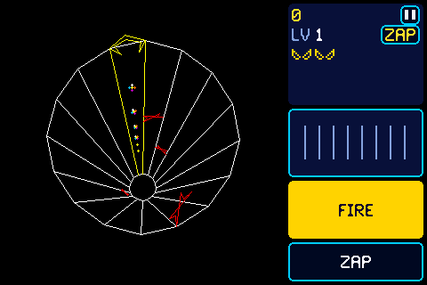
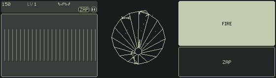

# ArashiPocket

ArashiPocket is Arashi for Palm OS. Spin round the rim of a tube and shoot the flippers, tankers, spikers, fuseballs and pulsars climbing up at you, then fly down the tube to the next level.

Arashi is Juri Munkki's Tempest clone for the classic Mac, from 1992. This port follows the original's game code closely, with all the original's levels, the original sounds, the attract mode and its demos, level select and high scores. It runs on everything from a 16 MHz Palm IIIx to a Tungsten TX, one build for all of them, in black and white, greys or colour.

This is release 0.2.2. It's been tested in the Frond emulator but not on a real Palm yet, so let me know what works and what doesn't [on my discord](https://discord.gg/9Wun47jGC6), or open an issue here.

Enjoy, 
Dan

---

## Screenshots

<table>
  <tr>
    <td align="center"> Menu, Palm TX</td>
    <td align="center"> Level 1, Palm TX</td>
    <td align="center"> Select level, Palm TX</td>
  </tr>
  <tr>
    <td align="center"> Palm IIIx</td>
    <td align="center"> Menu, Palm IIIx</td>
    <td align="center"> Tungsten E2</td>
  </tr>
  <tr>
    <td align="center" colspan="3"> Tapwave Zodiac</td>
  </tr>
  <tr>
    <td align="center" colspan="3"> AlphaSmart Dana</td>
  </tr>
</table>

All from the [Frond](https://github.com/roge-rm/frond) emulator.

## What's new in 0.2.2

- The hard buttons work as usual on every screen except the game itself, so Home (or any app button) leaves the game

---

## Devices

Palm OS 3.1 and up, from 160×160 greys to 320×480 colour, 480×320 landscape and the Dana's 560×160. It's been tested in Frond on a Palm IIIx, m100, Vx, IIIc and m505, a Clié T415 and TG50, a Tungsten E2, a TX, a Tapwave Zodiac and an AlphaSmart Dana.

The play area is the largest square that fits the screen, and the spare space on a TX, Zodiac or Dana holds a panel with the score, level and lives, a strip to drag and Fire, Zap and pause buttons. On the Dana the tube sits in the middle, with the score and the drag strip on its left and Fire and Zap on its right. The game runs at the original's 20 steps a second on every device. On the IIIx the picture keeps up at about 16 to 20 frames a second, a little less on busy spiker levels.

OS 5 devices (Tungsten E2, TX, Zodiac) play the original's sampled sounds. Older devices and the TG50 play a short tone for each sound.

## Install

Download `ArashiPocket-0.2.2.prc` from the releases page and install it with HotSync, or beam it from another Palm. It takes about 390 KB, most of it the sounds.

## Playing

The title leads to the menu: Play, Select level, High scores, Options and About. Tap a button, or move with the 5-way up and down and press the centre. On the menus the hard buttons work as usual, so Home (or any app button) leaves the game.

Select level starts on any level you've reached where the original allows a restart, with the start bonus it gives. Options has:
- Control: Touch moves the claw straight to the lane nearest the stylus, Drag moves it as far round as you drag
- Mode: Arcade or Practice, each with its own high scores
- Sound: on or off

Pause with the Menu button (silkscreen or hard), the pause button on the score panel, by tapping outside the tube where there's no panel, or by pressing fire and superzap together. The pause menu has Resume, the control setting and Quit. P on a keyboard pauses too.

Controls:
- Buttons 1 and 2, or the 5-way left and right: move round the rim a lane at a time, held to keep going
- Button 3, the 5-way centre or up, or page up: fire
- Button 4, the 5-way down, or page down: superzap
- Stylus: touch or drag round the rim to move the claw
- Screens with room beside or under the tube (T|X, Zodiac, Dana) have a strip to drag sideways like a spinner, and Fire and Zap buttons
- Clié Jog Dial: turn to move a lane a click, press to fire
- Zodiac: the stick moves and the buttons fire; superzap is untested

## Building

Needs prc-tools-remix, PilRC, Python 3 and the Palm OS SDK 5r3 in `../palm-os-sdk`.

- `make` builds `build/Arashi.prc`, and `make release` copies it to `build/ArashiPocket-0.2.2.prc`
- `make host` builds the game with the PC's gcc and runs the tests
- `make EXTRA=-DDEBUG_HEAP` shows the free memory, `-DGAME_PROFILE` the frame times and `-DDEBUG_LEVELS` lets the superzap skip levels
- `make check-data` checks the game data pulled from the original's resource fork

## Licence

MIT, see LICENSE. The original Arashi is by Juri Munkki and the Project STORM team who worked on it with him, credited on the title's attract pages, also MIT.
